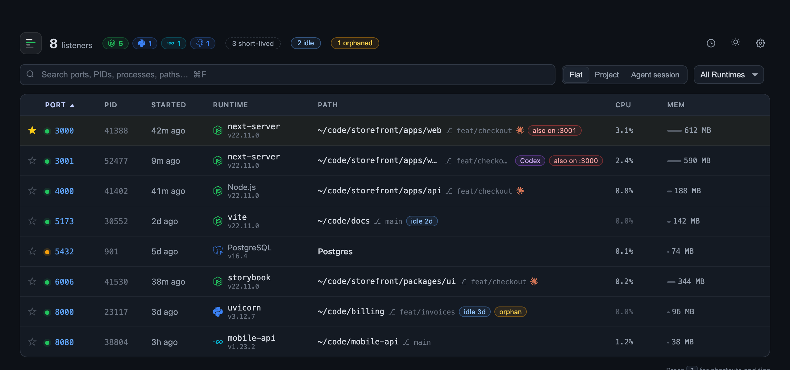

<p align="center">
  
</p>

<h1 align="center">DevDock</h1>

<p align="center">Every dev server on your Mac, what started it, and one click to stop it.</p>

<p align="center">
  <a href="https://github.com/Osama-Yusuf/devdock/releases/latest"><b>Download for macOS</b></a>
</p>

---

Forgotten servers pile up: an old branch still on :3000, a database from last week, something holding the port you need. DevDock lists every listening port with the project and branch behind it, so you can tell what is safe to kill.

Built lean: no frontend framework, under 1% CPU at idle, and the dashboard updates within a second of a port going up or down.

## Why

<p align="center"></p>

**"Port 3000 is already in use."** Instead of `lsof -i :3000` and a `ps` hunt, find the port and see the project, branch and how long it's been up. Kill it from the same row.

**The server you forgot.** A terminal closed days ago and `uvicorn` is still holding :8000. DevDock tags it `orphan` and `idle 3d`, and can stop idle servers for you.

**Two of the same app.** When a coding agent can't tell your dev server is already up, it starts another one on the next free port. DevDock marks both copies `also on :3001` and shows which session started each, so you can stop a whole session's servers in one click.

<p align="center"></p>

## Features

- **Know what's running.** Port, project folder, git branch, runtime and version, CPU, memory, and how long it's been up.
- **See who started it.** Group by project, or by the terminal session that launched it. Works with coding agents too, like Claude Code, Codex and Cursor.
- **Clean up fast.** Kill one server, a whole group, or everything matching a search. Enter confirms.
- **Catch the leftovers.** Flags idle servers, orphans whose terminal is gone, and duplicate servers on the same project. Idle servers can be auto-killed.
- **No false alarms.** Short-lived listeners from test runs and health probes are kept out of the table. Up and down notifications fire only once a change holds.
- **Jump in.** Tail a server's logs, open its project in your editor, open a terminal there, or copy the path.
- **History.** Stopped servers are remembered and can be restarted from where they ran.
- **Feels native.** Menu bar icon with a live count, launch at login, and standard Mac shortcuts (⌘, ⌘F ⌘1–3 ⌘Y, and `?` for the rest).

## Install

1. Download the `.dmg` from the [latest release](https://github.com/Osama-Yusuf/devdock/releases/latest) and drag DevDock to Applications.
2. The app isn't notarized yet, so macOS blocks the first launch. Run this once:

   ```bash
   xattr -dr com.apple.quarantine /Applications/DevDock.app
   ```

   Or open it, then allow it under System Settings → Privacy & Security → Open Anyway.

Requires macOS on Apple Silicon.

## Development

```bash
git clone https://github.com/Osama-Yusuf/devdock.git
cd devdock
npm install
npm start           # run the app
npm run build:mac   # build the .dmg into dist/
```

The screenshots come from demo mode, which runs the real UI on seeded data: `DEVDOCK_DEMO=1 PORT=4010 node server.js`.

Express and WebSocket on the backend, plain HTML, CSS and JavaScript on the front, in an Electron shell.
