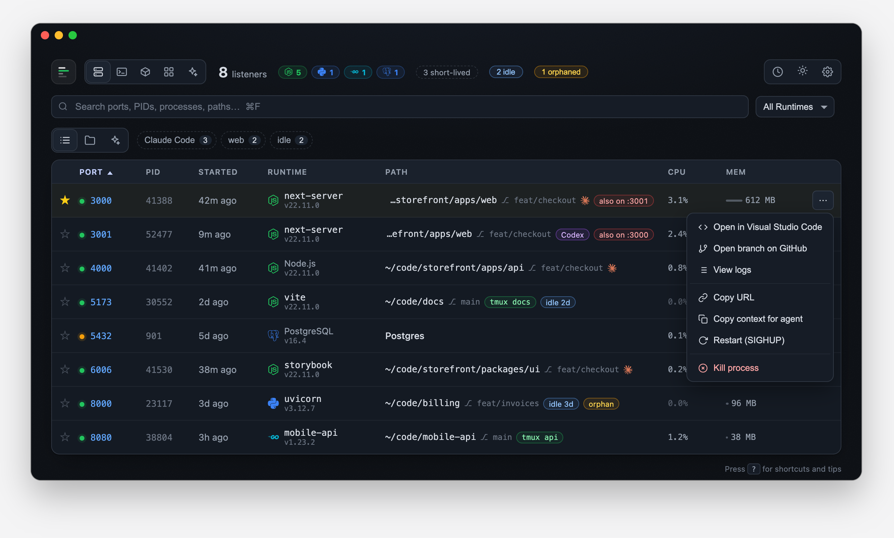
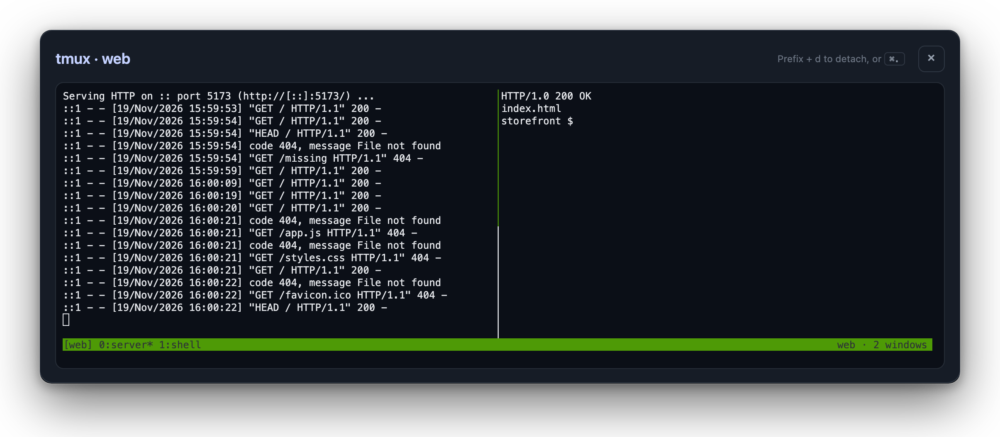
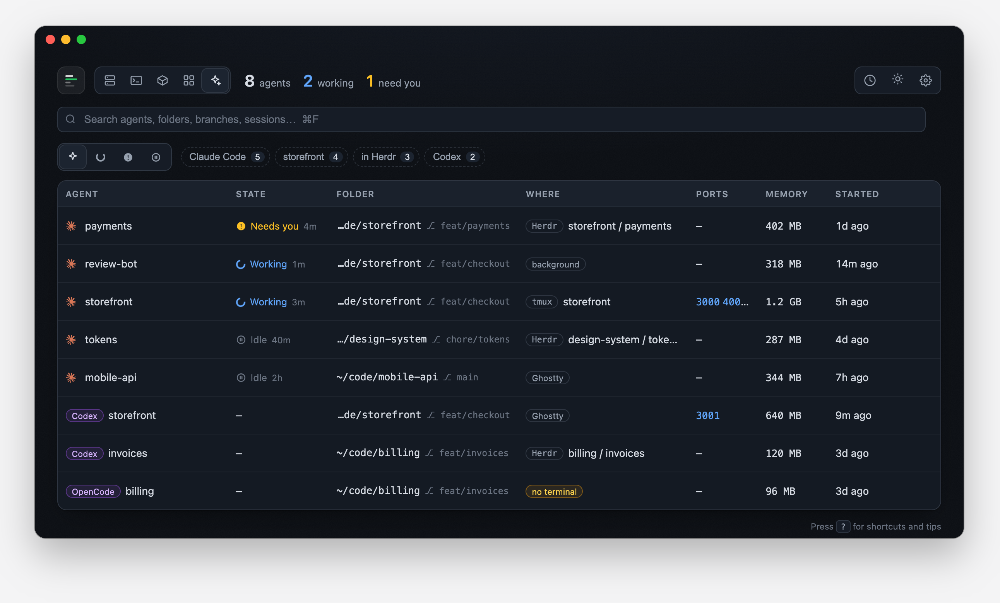
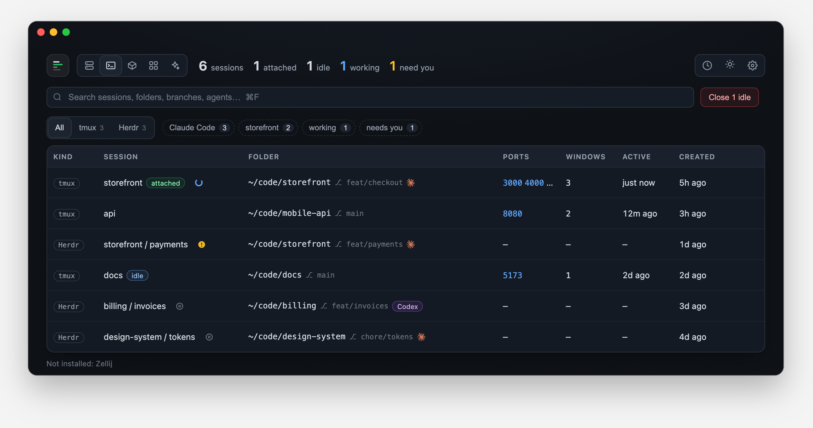
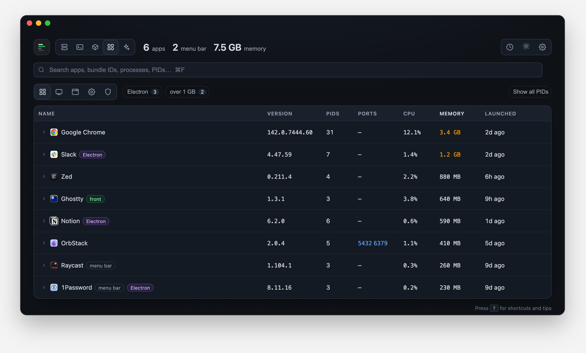
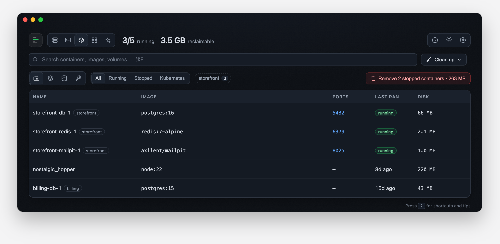
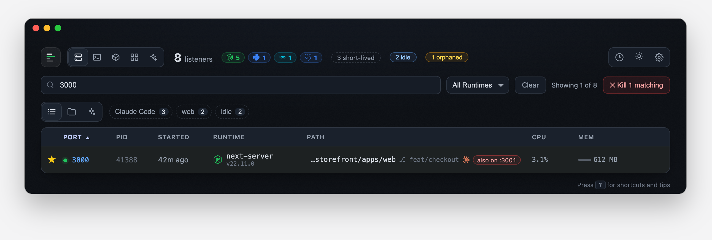
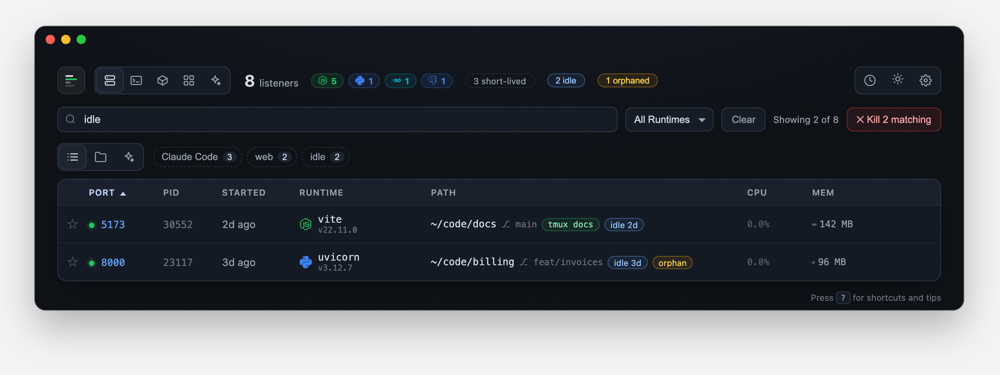

<p align="center">
  
</p>

<h1 align="center">DevDock</h1>

<p align="center"><b>Everything running. One dock.</b><br />Servers, sessions, containers, apps and agents. See who started what and who's waiting on you, then jump in or shut it down.</p>

<p align="center">
  <a href="https://github.com/Osama-Yusuf/devdock/releases/latest"><b>Download for macOS</b></a>
</p>

<p align="center"></p>

<p align="center">Built lean: no frontend framework, under 1% CPU at idle, and changes show up within a second.<br />
<sub>Click a port to open it · click a PID or path to copy it · right-click a path to open a terminal there</sub></p>

## Features

- 🔍 **See everything:** port, project, git branch, runtime, CPU, memory, uptime.
- 🧭 **Know who started it:** group by project or by session, coding agents included.
- 🧹 **Clean up fast:** kill one server, a whole group, or every search match.
- 👻 **Catch leftovers:** idle, orphaned and duplicate servers get flagged. Idle ones can auto-stop.
- 🎯 **No noise:** short-lived test listeners stay hidden, and alerts fire only on real changes.
- 🛠️ **Jump in:** open in your editor, open the branch on GitHub, tail logs.
- 🪟 **tmux aware:** see which pane runs each server and work in it without leaving DevDock.
- 🕘 **History:** restart servers you stopped earlier.
- ⌨️ **Feels native:** menu bar count, launch at login, Mac shortcuts with on-screen hints.

Everything else lives in each row's menu: hover a row and click `⋯`.

<p align="center"></p>

Click a server's `tmux` badge and its session opens right here, splits and windows included.

<p align="center"></p>

## Tabs

| Tab | What it shows |
|---|---|
| **Servers** `⌘1` | Every listening port: flat, by project, or by the agent session that started it. |
| **Sessions** `⌘2` | tmux and Herdr sessions with their folders, branches and ports. Open, rename or kill them, and see which Claude Code ones are working, waiting on you, or idle. |
| **Containers** `⌘3` | Docker containers, images, volumes and build cache, with one-click cleanup. |
| **Apps** `⌘4` | Running Mac apps, menu bar apps and background agents, with every PID they own. Quit, force quit, or kill a single process. |
| **Agents** `⌘5` | Every coding agent running (Claude Code, Codex, OpenCode): what it's doing, where it lives, what it started. Click one to jump to its tmux pane, Herdr terminal or Ghostty tab. |

DevDock reads Claude Code's own status, so it doesn't guess whether a session is working, waiting on a permission prompt, or done. Codex and OpenCode don't report this, so they show no state.

<p align="center"></p>

<p align="center"></p>

<p align="center"></p>

<p align="center"></p>

## Shortcuts

Hold `⌘`, `⌥` or `⌃` and every button you can reach shows the key to press next.

| Keys | Does |
|---|---|
| `⌘1` – `⌘5` | Switch tab |
| `⌥1` – `⌥9` | Switch inside a tab: grouping, multiplexer, container type, app kind, agent state |
| `⌃1` – `⌃9` | Turn a discovered pattern on or off |
| `⌘F` | Search |
| `⇧⌘G` | Next server grouping |
| `⌘⇧↵` | Terminal fills the window |
| `⌘.` | Close the terminal |
| `⌘,` `⌘Y` | Settings, history |
| `⇧⌘L` `⇧⌘E` | Light/dark, export |
| `?` | All shortcuts and tips |

Drag across rows to select them. `⇧` or `⌘` while dragging adds or removes rows.

## Install

1. Download the `.dmg` from the [latest release](https://github.com/Osama-Yusuf/devdock/releases/latest) and drag DevDock to Applications.
2. The app isn't notarized yet, so macOS blocks the first launch. Run this once:

   ```bash
   xattr -dr com.apple.quarantine /Applications/DevDock.app
   ```

   Or open it, then allow it under System Settings → Privacy & Security → Open Anyway.

Requires macOS on Apple Silicon.

## Why

1. **"Port 3000 is already in use."**
   - **Before:** `lsof -i :3000`, then `ps` to work out which project that PID belongs to, then `kill`.
   - **With DevDock:** search `3000`, see the project, branch and uptime, kill it from the row.

   

2. **The server you forgot.** A terminal closed days ago, and `uvicorn` is still holding :8000.
   - **Before:** you find out when something else can't start, or from the fan.
   - **With DevDock:** search `idle` and it's there, tagged `orphan` and `idle 3d`. Stop it, or let DevDock stop idle servers for you.

   

3. **Two copies of the same app.** A coding agent doesn't see your dev server is up and starts another one on the next free port.
   - **Before:** two servers on the same code, and you're testing the stale one.
   - **With DevDock:** both are marked `also on :3001`, grouped by the session that started them. Stop a whole session in one click.

   

## Development

```bash
git clone https://github.com/Osama-Yusuf/devdock.git
cd devdock
npm install
npm start           # run the app
npm run build:mac   # build the .dmg into dist/
```

The screenshots come from demo mode, which runs the real UI on seeded data: `DEVDOCK_DEMO=1 PORT=4010 node server.js`.

Express and WebSocket on the backend, plain HTML, CSS and JavaScript on the front, in an Electron shell.
