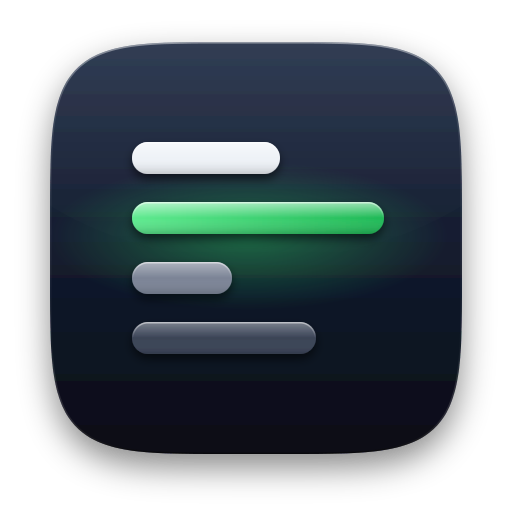

<p align="center">
  
</p>

<h1 align="center">DevDock</h1>

<p align="center">Every dev server on your Mac, which project and agent started it, and one click to stop it.</p>

<p align="center">
  <a href="https://github.com/Osama-Yusuf/devdock/releases/latest"><b>Download for macOS</b></a>
</p>

---

Coding agents and vibe-coding sessions leave servers running everywhere. DevDock lists every listening port with the project, branch and session behind it, so you can tell what is safe to kill.

Built lean: no frontend framework, under 1% CPU at idle, and the dashboard updates within a second of a port going up or down.

## Features

- **Know what's running.** Port, project folder, git branch, runtime and version, CPU, memory, and how long it's been up.
- **See who started it.** Group by project or by agent session: Claude Code, Codex, Gemini CLI, Cursor Agent, Aider, opencode and more.
- **Clean up fast.** Kill one server, a whole group, or everything matching a search. Enter confirms.
- **Catch the leftovers.** Flags idle servers, orphans whose terminal or agent is gone, and duplicate servers on the same project. Idle servers can be auto-killed.
- **No false alarms.** Short-lived listeners from tests and agent probes are kept out of the table. Up and down notifications fire only once a change holds.
- **Jump in.** Tail a server's logs, open its project in your editor, open a terminal there, or copy the path.
- **History.** Stopped servers are remembered and can be restarted from where they ran.
- **Feels native.** Menu bar icon with a live count, launch at login, and standard Mac shortcuts (⌘, ⌘F ⌘1–3 ⌘Y, and `?` for the rest).

## Install

1. Download the `.dmg` from the [latest release](https://github.com/Osama-Yusuf/devdock/releases/latest) and drag DevDock to Applications.
2. The app isn't notarized yet, so macOS blocks the first launch. Run this once:

   ```bash
   xattr -dr com.apple.quarantine /Applications/DevDock.app
   ```

   Or open it, then allow it under System Settings → Privacy & Security → Open Anyway.

Requires macOS on Apple Silicon.

## Development

```bash
git clone https://github.com/Osama-Yusuf/devdock.git
cd devdock
npm install
npm start           # run the app
npm run build:mac   # build the .dmg into dist/
```

Express and WebSocket on the backend, plain HTML, CSS and JavaScript on the front, in an Electron shell.
