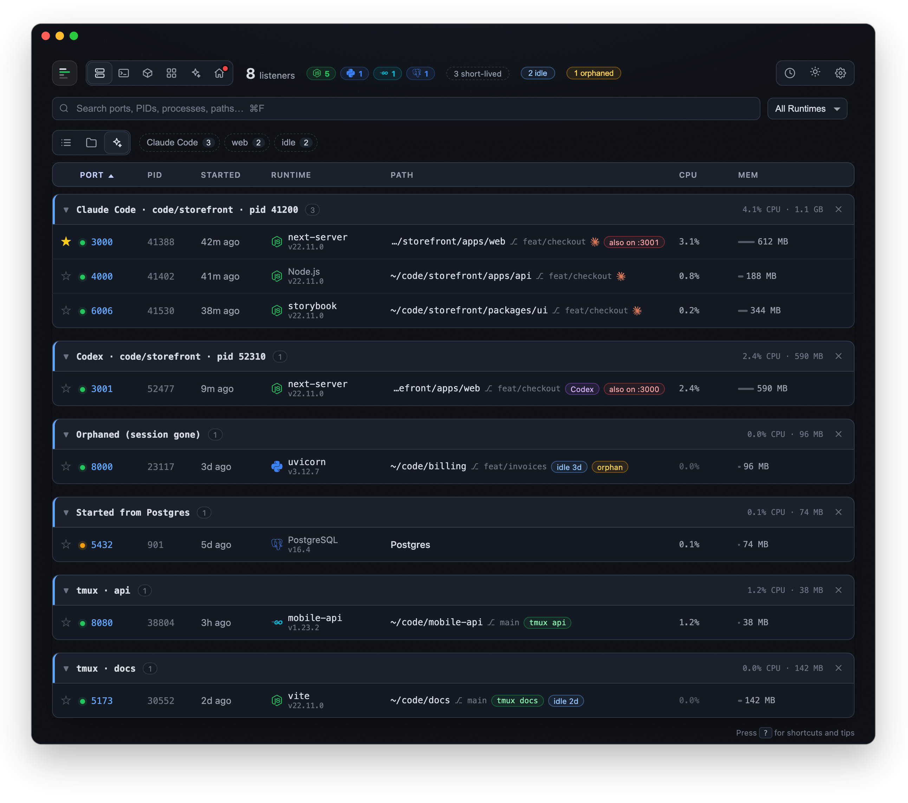

<p align="center">
  
</p>

<h1 align="center">DevDock</h1>

<p align="center">Every dev server on your Mac, what started it, and one click to stop it.</p>

<p align="center">
  <a href="https://github.com/Osama-Yusuf/devdock/releases/latest"><b>Download for macOS</b></a>
</p>

<p align="center"></p>

<p align="center">Built lean: no frontend framework, under 1% CPU at idle, and changes show up within a second.<br />
<sub>Click a port to open it · click a PID or path to copy it · right-click a path to open a terminal there</sub></p>

## Features

- 🔍 **See everything:** port, project, git branch, runtime, CPU, memory, uptime.
- 🧭 **Know who started it:** group by project or by session, coding agents included.
- 🧹 **Clean up fast:** kill one server, a whole group, or every search match.
- 👻 **Catch leftovers:** idle, orphaned and duplicate servers get flagged. Idle ones can auto-stop.
- 🎯 **No noise:** short-lived test listeners stay hidden, and alerts fire only on real changes.
- 🛠️ **Jump in:** logs, editor and terminal from the row menu.
- 🕘 **History:** restart servers you stopped earlier.
- ⌨️ **Feels native:** menu bar count, launch at login, Mac shortcuts.

## Install

1. Download the `.dmg` from the [latest release](https://github.com/Osama-Yusuf/devdock/releases/latest) and drag DevDock to Applications.
2. The app isn't notarized yet, so macOS blocks the first launch. Run this once:

   ```bash
   xattr -dr com.apple.quarantine /Applications/DevDock.app
   ```

   Or open it, then allow it under System Settings → Privacy & Security → Open Anyway.

Requires macOS on Apple Silicon.

## Why

1. **"Port 3000 is already in use."**
   - **Before:** `lsof -i :3000`, then `ps` to work out which project that PID belongs to, then `kill`.
   - **With DevDock:** search `3000`, see the project, branch and uptime, kill it from the row.

   

2. **The server you forgot.** A terminal closed days ago, and `uvicorn` is still holding :8000.
   - **Before:** you find out when something else can't start, or from the fan.
   - **With DevDock:** search `idle` and it's there, tagged `orphan` and `idle 3d`. Stop it, or let DevDock stop idle servers for you.

   

3. **Two copies of the same app.** A coding agent doesn't see your dev server is up and starts another one on the next free port.
   - **Before:** two servers on the same code, and you're testing the stale one.
   - **With DevDock:** both are marked `also on :3001`, grouped by the session that started them. Stop a whole session in one click.

   

## Development

```bash
git clone https://github.com/Osama-Yusuf/devdock.git
cd devdock
npm install
npm start           # run the app
npm run build:mac   # build the .dmg into dist/
```

The screenshots come from demo mode, which runs the real UI on seeded data: `DEVDOCK_DEMO=1 PORT=4010 node server.js`.

Express and WebSocket on the backend, plain HTML, CSS and JavaScript on the front, in an Electron shell.
